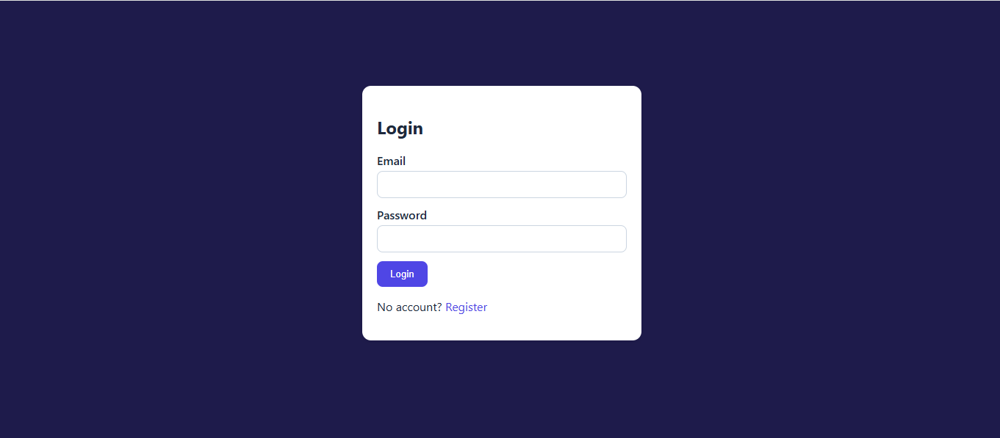
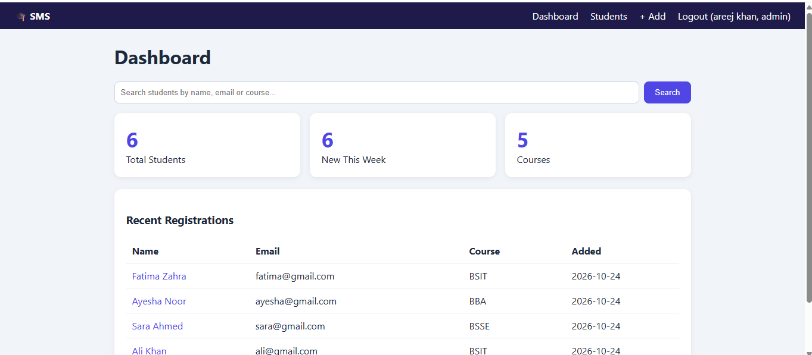
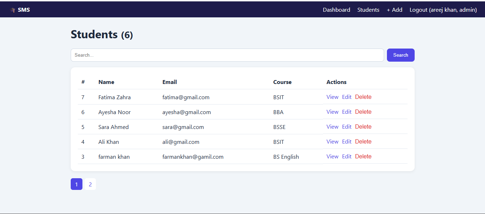
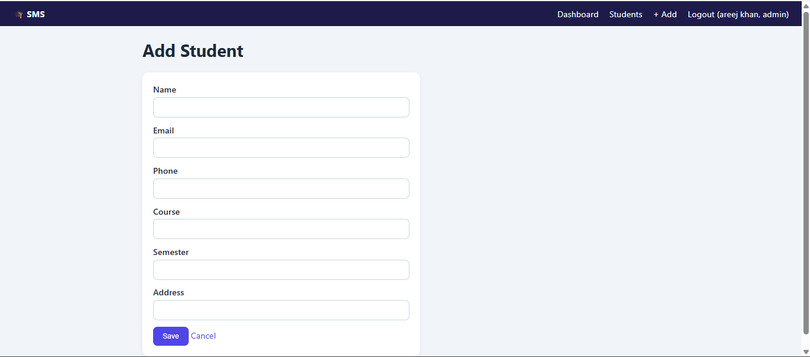
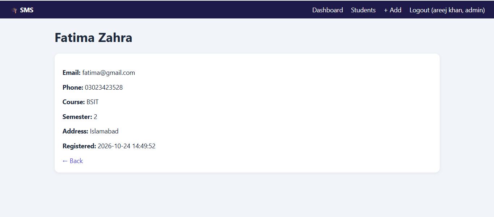
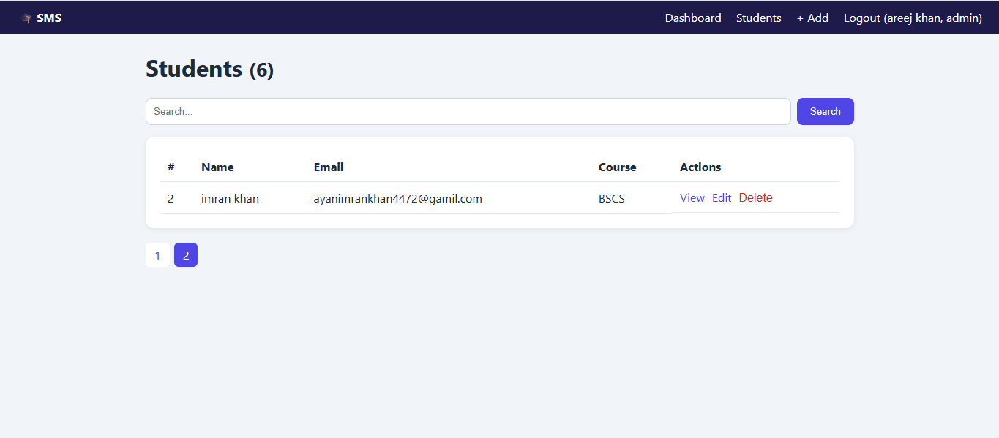
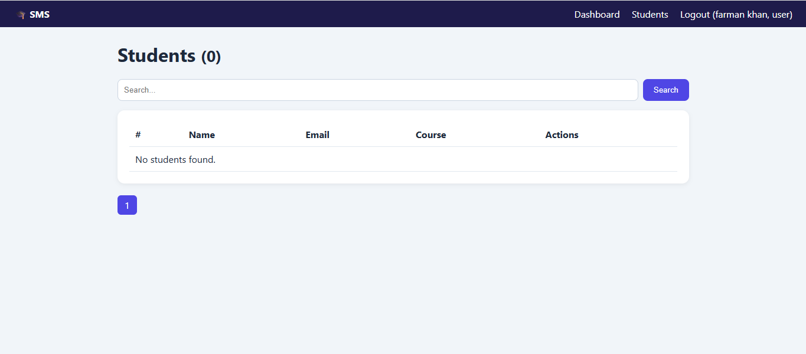

# Student Management System

A full-stack Student Management System built with **HTML, CSS, JavaScript, PHP and MySQL** for the Devixo Solutions Web Development Internship (Task 03).

## Features

- **Authentication:** register, login and logout with hashed passwords
- **Role-based access:** the first registered account becomes Admin. Other accounts are Users with view and search access only
- **Student module:** add, edit, delete, search and view student details
- **Dashboard:** total students, new registrations this week, number of courses, recent registrations and a search bar
- **Pagination:** 5 students per page
- **Database:** all records are stored permanently in MySQL
- **UI:** responsive design, form validation (browser and server) and a loading indicator
- **Security:** prepared statements (SQL injection protection), CSRF tokens and escaped output

## Technologies

HTML5, CSS3, JavaScript, PHP 8, MySQL (XAMPP)

## Setup

1. Install [XAMPP](https://www.apachefriends.org) and start **Apache** and **MySQL**.
2. Copy this project folder into the `htdocs` folder of XAMPP.
3. Open `http://localhost/phpmyadmin`, click **Import**, choose `database.sql` and click **Import**.
4. Open `http://localhost/student-management/` in your browser.
5. Register an account. The first account is the Admin.

## Screenshots

### Login


### Dashboard


### Students List


### Add Student


### Student Details


### Pagination (Page 2)


### User Role (no Add, Edit or Delete options)

## Project Structure

```
student-management/
├── assets/            # style.css, script.js
├── screenshots/
├── config.php         # database connection and helper functions
├── database.sql       # database and tables
├── login.php, register.php, logout.php
├── dashboard.php
├── students.php, student_form.php, student_view.php, student_delete.php
└── header.php, footer.php, index.php
```

## Author

Areej Khan, BS Computer Science, Virtual University of Pakistan